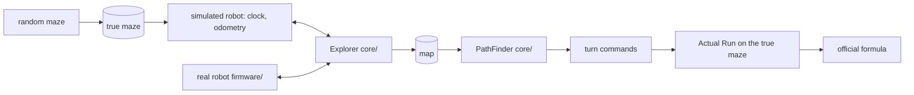

# meshmerize-sim

A maze-solving brain for a Meshmerize line-following robot, plus the
simulator that proves it works before you have a working robot.

```
 PC                                          ESP32
 make test       run the tests               make firmware   compile the robot
 make show       look at one maze            make flash      upload it
 make compare    which strategy scores best  make monitor    serial test menu
```

Needs only `g++` and `make` on the PC side. The robot side needs
PlatformIO (`pip install platformio`), nothing else.

---

## Why this exists, in plain words

In Meshmerize your robot gets two runs. First a **Dry Run**: it drives
through an unknown maze of white lines, finds the End and remembers what it
saw. Then an **Actual Run**: back at the Start, it must drive the
**shortest** route to the End. Points come from finishing both runs, from
being fast, and most of all from really driving the shortest route: that
alone is worth about 160 of the roughly 400 points on offer.

The trap: during the Dry Run every second costs one point, so you want to
stop exploring early. But if you stop too early you may never see the
shorter corridor two junctions over, and then the 160 points are gone.
When is it worth exploring more? Nobody can answer that by staring at one
maze. You answer it by playing thousands of mazes, and that is what a
simulator is for.

This project gives you three things:

1. **The brain** (`core/`): code that explores a maze, builds a map, finds
   the shortest route and converts it to turn commands. Written so the
   exact same files run in the simulator and on the ESP32. No "it worked
   on the PC but the robot does something else".
2. **The simulator** (`sim/`, `tools/`): random mazes, a model of your
   robot's speed, the official scoring formula, and a batch runner that
   compares exploration strategies over hundreds of mazes.
3. **The firmware** (`firmware/`): a ready ESP32 project with a serial
   test menu for bringing up the sensors, motors and encoders one at a
   time, and the competition flow (button, Dry Run, red LED, Actual Run).
   You edit one file to describe your hardware.

You do not need to understand the brain to use it. You need to be able to
read the result tables, tune your robot in the test menu, and change one
line (`POLICY`) to pick a strategy.

---

## If you are the hardware person

You know your sensors, your motors and your ESP32. Here is the whole
workflow without touching the maze code:

```
1. firmware/src/config.h     write down your pins and wiring
2. make flash; make monitor  bring up IR, motors, encoders, line following, turns
                             with the numbered menu tests; each one tells you
                             which constant to change
3. robot.cfg                 copy the speeds you measured into the simulator
4. make compare ROBOT=robot.cfg   see which strategy wins for YOUR robot
5. config.h: POLICY = ...    set that strategy, flash again
6. tape a test maze, press the button
```

The step-by-step bring-up guide, with what each test prints and what to do
about it, is in [firmware/README.md](firmware/README.md).

### Where your hardware knowledge goes

| I want to... | edit |
|---|---|
| set pins, sensor count, analog/digital IR, motor wiring, wheel size, speeds, PID, strategy | [firmware/src/config.h](firmware/src/config.h) |
| use a different IR array, change how "I see a branch" is decided | [firmware/src/sensors.h](firmware/src/sensors.h) |
| use a different motor driver (DRV8833, L298N) or encoder scheme | [firmware/src/motors.h](firmware/src/motors.h) |
| change how the robot follows the line, detects junctions, turns | [firmware/src/drive.h](firmware/src/drive.h) |
| add my own test to the serial menu | [firmware/src/menu.h](firmware/src/menu.h) |

The IR array is assumed to be an 8-channel analog reflectance array
(QTR-8A style) because that is the most common choice, but it is fully
configurable: sensor count, pins, analog or digital, which way the readings
go on white, spacing, how many outer sensors must light up to count as a
branch, and the calibration is done live from the menu and stored in
flash. If you end up with a 5-sensor digital bar, change four constants.

### What the firmware promises and what it does not

The firmware **compiles** for `esp32dev` (Arduino core 3.x, 31% RAM) and
the maze logic in it is the same code that passes 260 checks on the PC.
It has **not been driven on a real robot yet**. Expect to spend the first
afternoon with hardware tuning `config.h` and probably the junction
detection in `drive.h`. The serial menu exists exactly for that afternoon.

---

## Tutorial (PC side)

### 1. Build and run the tests

```sh
make test
```

Prints `name: OK` for 260 checks. Stops at the first `FAIL`, and the
name tells you what broke ("prune: visits A but not B").

### 2. Look at a maze

```sh
make show SEED=4 W=6 H=6 LOOPS=2
```

```
maze seed 4, 6x6 cells of 230 mm, 2 loop(s), 0 checkpoint(s)
25 nodes, 26 edges, 37 passages
true shortest: 2760 mm, 8 turns, 7.71 s at Actual Run pace

+---+---+---+---+---+---+
|*S  *                  |
+---+   +   +---+---+   +
|*   *      |           |
+   +---+   +   +---+---+
|*   *  |   |           |
+   +   +   +---+---+   +
|   |*  |       |       |
+   +   +---+---+   +---+
|   |*   *   *  |       |
+   +---+---+   +---+   +
|           |*   *   *E |
+---+---+---+---+---+---+
route as driven: E1 S1 W1 S1 E1 S2 E2 S1 E2   (direction + cells, 8 turns)
```

Same seed, same maze, on every computer. `LOOPS` adds wall openings; each
one creates exactly one loop. `LOOPS=0` is a maze with a single route.

### 3. Watch a strategy drive it

```sh
make show SEED=4 W=6 H=6 LOOPS=2 STRAT=first-path
```

```
== first-path: stop the moment End is seen (depth-first) ==
  dry run     14.56 s  reached End
  actual       9.78 s  reached End, route 3680 mm vs true 2760 mm
  points    A 0 + B 30 + C 165.44 + S 0 + L 5 + T 0.00 - P 0 = 200.44

+---+---+---+---+---+---+
|*S  *   *   *   *   *  |
+---+   +   +---+---+   +
|           |*   *   *  |
+   +---+   +   +---+---+
|       |   |*   *   *  |
+   +   +   +---+---+   +
|   |   |       |*   *  |
+   +   +---+---+   +---+
|   |           |*   *  |
+   +---+---+   +---+   +
|           |        *E |
+---+---+---+---+---+---+
3 exit(s) were left untried
```

It found End in 14.6 s, stopped, and retraced a 3680 mm route. The real
shortest is 2760 mm, so S and T (about 140 points) are lost. Add
`EXTRA=--all` to see everyone on the same maze:

```
strategy          total   dry s   run s short  sure drove m
first-path       200.44   14.56    9.78    no    no    3.68
dfs-full         332.61   54.68    7.71   yes   yes   13.34
prune-grid       338.19   49.10    7.71   yes   yes   11.50
wall-left        200.44   14.56    9.78    no    no    3.68
```

Forty seconds more exploring bought 138 points here. Try `SEED=5`: there
every strategy scores the same because the first route is already the
shortest. One maze proves nothing, hence the next step.

### 4. Compare strategies over many mazes

```sh
make compare SEEDS=300
```

```
strategy          score      sd  short%   sure%   dry s   >180%   run s walked m
first-path        233.4    84.8    53.7     0.0    67.2     0.0    22.6     16.6
dfs-full          202.2    13.2   100.0   100.0   181.6    51.7    19.9     44.1
nearest-full      205.0    14.8   100.0   100.0   176.9    43.0    19.9     42.9
prune             238.0    44.2   100.0   100.0   141.3    25.0    20.0     34.5
prune-grid        243.3    46.8   100.0   100.0   135.6    23.3    20.0     33.1
prune-guard       225.1    81.4    84.0    63.7   124.1     0.0    21.2     30.4
nearest-guard     207.8    44.5    91.3    24.7   153.7     0.0    20.2     37.3
wall-left         212.4    87.0    37.3     0.0    62.7     0.0    24.1     15.6
```

`score` mean points; `sd` how much it swings between mazes; `short%` how
often the robot really drove a shortest route; `sure%` how often it could
*prove* nothing shorter was left; `dry s` Dry Run time; `>180%` how often
it overran the 3 minutes; `walked m` metres driven exploring.

Knobs: `SEEDS`, `W`, `H`, `LOOPS`, `CPS` (checkpoints), `ROBOT=robot.cfg`,
`CSV=out.csv`, `EXTRA="--margin 5 --by-time"`. `./build/compare --help`
lists everything.

### 5. Put your robot's numbers in

[robot.cfg](robot.cfg) holds how fast your robot drives, how long it loses
at a junction, a corner and a dead-end turnaround, separately for the Dry
Run and the Actual Run. The shipped values are **guesses**. Replace them
with what you measured (procedure below) and run `make compare
ROBOT=robot.cfg`. Until then, trust the *ranking* of strategies, not the
seconds.

### 6. Make the simulated robot as clumsy as the real one

Set `odom.enabled = 1` in `robot.cfg`. Now the explorer is no longer told
which junction it is standing on; it has to recognise places from its
drifting wheel-encoder position, like the real robot. Two things can go
wrong, and both show up in the results instead of being hidden: a missed
loop (same place mapped twice, costs time) and a false merge (two places
confused, reported as a failed Dry Run). `odom.merge_mm` is the knob.

### 7. Write your own strategy

Two ways. **Configure the built-in explorer**: `ExploreConfig` in
[core/explorer.h](core/explorer.h) has the switches (stop at End, frontier
order, pruning, time guard); add a line to `builtinStrategies()` in
[sim/strategies.h](sim/strategies.h). **Or bring your own algorithm**: write

```cpp
ExploreResult myExplore(TimedWalker& w, MazeGraph& known);
```

drive `w` during the Dry Run, record what you learn in `known`, and add it
as `Strategy{"my-name", "what it does", ExploreConfig{}, myExplore}` in
`tools/compare.cpp`. It is scored like everyone else: the simulator takes
the shortest route from *your* map, converts it to commands and replays
them on the real maze. A wrong map shows up as a failed run, not as a good
score. [examples/wall_follower.h](examples/wall_follower.h) is a complete
60-line example.

The thing you drive is the **Walker**, the same interface the real robot
implements in `firmware/src/robot_walker.h`:

| call | meaning |
|---|---|
| `here()` | node id, or `-1` when the robot cannot know (odometry mode, real robot) |
| `type()` | `Start`, `End`, `CheckPoint`, `DeadEnd`, `Normal` |
| `exitCount()` | corridors leaving this node |
| `backExit()` | index of the corridor we arrived through (`-1` at Start) |
| `go(k)` | drive through corridor `k`; returns mm driven, or `-1` and stays put |
| `totalMm()` | distance so far |
| `xMm()`, `yMm()` | position estimate of this node |

Record `known.addEdge(a, b, len, cmd_at_a, cmd_at_b)` so the route can be
replayed. No randomness except `Rng` with a fixed seed, no peeking at the
true maze, finish standing on End.

---

## What the numbers say (placeholder robot, 10x10, 3 loops)

- **Stopping at the first route is a coin flip.** 54% shortest. When it
  misses, ~140 points are gone. Biggest spread of all.
- **Mapping everything is safe but slow.** Always shortest, but the Dry
  Run averages 180 s and overruns 3 minutes in half the mazes.
- **Pruning is the sweet spot.** Once End is seen, skip every unexplored
  exit that cannot possibly lead to a shorter route (known distance to it
  plus straight line to End is already too long). `prune-grid` keeps the
  100% guarantee while driving 25% less. Best scorer here.
- **The time guard loses points in this setup**: giving up the search
  forfeits ~160 to protect at most ~45. This depends on a rule nobody has
  confirmed: if overrunning the Dry Run only zeroes C, do not guard; if it
  voids the attempt, guard. **Ask the organisers.**
- **Maze size dominates.** On 8x8 nobody overruns and pruning reaches 296
  vs 268 for first-path. On 12x12 the placeholder robot often cannot even
  find End in time. Cell size matters more than algorithm choice.
- **Distance vs time** routes differ in under 2% of mazes.

Re-run after calibration; conclusions may move.

---

## Calibration (turn guesses into measurements)

1. **Speed**: 2 m straight tape line, time it in Dry Run mode and in
   Actual Run mode. `mm_per_s = 2000 / seconds`.
2. **Node cost**: add a T-junction halfway, time again. The difference is
   `node_ms`.
3. **Corner cost**: replace the T with a 90-degree corner. Difference
   minus `node_ms` is `turn_ms`.
4. **U-turn cost**: a dead end at the far end, out and back. The leftover
   after subtracting the straight parts is `uturn_ms`.
5. **Odometry**: drive 2 m ten times and read the robot's own distance
   (menu test 5). Mean relative error is `scale_err`, spread is `noise`.
   `merge_mm` must be well under half a cell and well over the drift along
   the longest corridor.

Put the numbers in **both** `robot.cfg` (simulator) and
`firmware/src/config.h` (robot), with the date as a comment.

---

## How it works, briefly



The maze is a **graph**: junctions, corners, dead ends, Start and End are
nodes; corridors are edges with a length in mm. Straight stretches of any
length are one edge. That is why the same code handles grids, loops and
later curved mazes.

Everything uses **fixed-size arrays**, no heap: `MazeGraph` 18 KB,
`Explorer` 15 KB, `PathFinder` 16 KB. On the ESP32 they are globals.

The **Explorer** keeps a list of untried exits. Each round: pick one
(deepest = classic DFS, or nearest), drive there along known corridors,
take it, record what is found. Pruning drops exits that cannot hold a
shorter route; the time guard refuses exits that would not fit in the
remaining time (estimated pessimistically). When nothing is left it drives
to End. Errors (`GraphFull`, `WalkerError`, `LostPosition`) are reported,
never swallowed.

The **PathFinder** is Dijkstra over *(node, direction arrived from)* so a
corner can be priced; ties go to fewer turns.

**Scoring** implements `A + B + C + S + L + T - P` from the Techfest page.
The Actual Run is really replayed on the true maze.

---

## Assumptions (rules do not say; change in one place)

| Unknown | Assumed | Where |
|---|---|---|
| Maze layout | grid, 90-degree corridors, loops possible | `core/maze_gen.h` |
| Cell size | 230 mm | `W`, `H`, `--cell`; `CELL_MM` in firmware |
| Robot timing | placeholders | `robot.cfg`, `config.h` |
| What End looks like | all sensors on line for 60 mm | `END_MARK_MM`, `drive.h` |
| Exits at Start | straight only | `START_EXITS` |
| "Shortest" | by distance | `Metric` default |
| Dry Run clock stops | on arrival at End | `sim/scoring.h` |
| Dry Run not completed | no B, C, L | `sim/scoring.h` |
| Dry Run over 180 s | C = 0, overrun shortens the Actual Run | `sim/scoring.h` |
| Checkpoints | random cells, counted once over both runs | `--checkpoints` |
| Penalties P | a number you pass in, default 0 | `AttemptSetup::penalties` |
| Restarts | not modelled | - |

---

## Layout

```
core/       portable C++17, runs on the PC and on the ESP32 unchanged
sim/        PC-only: simulated robot, scoring, strategies, batch, ASCII view
tools/      show.cpp, compare.cpp
tests/      one test_*.cpp per module, `make test`
examples/   wall_follower.h, a complete custom strategy
firmware/   PlatformIO project for the robot (see firmware/README.md)
robot.cfg   the simulated robot's timing and odometry
```

Conventions: `core/` has no iostream, STL containers, heap or exceptions;
lengths are integer mm, time integer ms; failed calls return `-1`/`false`
and change nothing; every feature has tests including bad input and at
least one implementation-independent invariant; test labels say what is
checked; warning-free build; no new dependencies.

Not done yet: restarts and penalties (only the `P` input exists); motor
lag / acceleration modelling; checkpoint-seeking strategies;
hardware-in-the-loop over serial; and, above all, a drive on a real robot.
