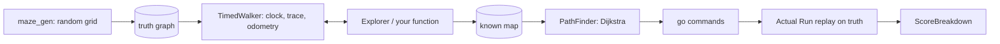

# meshmerize-sim

A small, dependency-free C++17 simulator and strategy lab for the
**Meshmerize** line-maze competition (Techfest, IIT Bombay).

It answers one question with numbers instead of opinions: *how much should
the robot explore during the Dry Run?* Every second of exploring costs a
point; missing the shortest path costs about 160. The simulator plays whole
attempts (Dry Run + Actual Run, official scoring) on hundreds of random mazes
and tells you which exploration policy wins, and when.

The maze logic in `core/` is written so that the very same files compile
for the ESP32 later: no heap, no STL containers, no iostream, integers in
millimetres.

```
 make test       build and run every test (zero warnings expected)
 make show       draw one maze, the true shortest route and a strategy's run
 make compare    score every strategy over hundreds of mazes
```

Requirements: `g++` (C++17) and GNU `make`. Nothing else. Developed against
g++ 11 on Ubuntu 22.04 and g++ 16 (MSYS2) on Windows.

---

## Tutorial

### 1. Build and run the tests

```sh
make test
```

Every test prints `name: OK` or `name: FAIL`, and `make` stops at the first
failing test program. The names are written so that a failure tells you
exactly what went wrong ("prune: visits A but not B: FAIL").

### 2. Look at a maze

```sh
make show SEED=4 W=6 H=6 LOOPS=2
```

```
maze seed 4, 6x6 cells of 230 mm, 2 loop(s), 0 checkpoint(s)
25 nodes, 26 edges, 37 passages
true shortest: 2760 mm, 8 turns, 7.71 s at Actual Run pace
fastest route is the same as the shortest one

+---+---+---+---+---+---+
|*S  *                  |
+---+   +   +---+---+   +
|*   *      |           |
+   +---+   +   +---+---+
|*   *  |   |           |
+   +   +   +---+---+   +
|   |*  |       |       |
+   +   +---+---+   +---+
|   |*   *   *  |       |
+   +---+---+   +---+   +
|           |*   *   *E |
+---+---+---+---+---+---+
S start, E end, C checkpoint, * shortest route
route as driven: E1 S1 W1 S1 E1 S2 E2 S1 E2   (direction + cells, 8 turns)
```

`SEED` picks the maze (same seed, same maze, on every machine). `LOOPS` is
the number of extra wall openings; each one adds exactly one loop, so
`LOOPS=0` is a perfect maze with a single route between any two cells.

### 3. Watch a strategy play

```sh
make show SEED=4 W=6 H=6 LOOPS=2 STRAT=first-path
```

```
== first-path: stop the moment End is seen (depth-first) ==
  dry run     14.56 s  reached End
  End seen    14.56 s into the dry run
  actual       9.78 s  reached End, route 3680 mm vs true 2760 mm
  map       13 nodes, 12 edges, drove 3.68 m, status 0
  points    A 0 + B 30 + C 165.44 + S 0 + L 5 + T 0.00 - P 0 = 200.44

+---+---+---+---+---+---+
|*S  *   *   *   *   *  |
+---+   +   +---+---+   +
|           |*   *   *  |
+   +---+   +   +---+---+
|       |   |*   *   *  |
+   +   +   +---+---+   +
|   |   |       |*   *  |
+   +   +---+---+   +---+
|   |           |*   *  |
+   +---+---+   +---+   +
|           |        *E |
+---+---+---+---+---+---+
. explored in the dry run, * route retraced in the actual run
3 exit(s) were left untried
```

The robot found End after 14.6 s and stopped. It then retraced a 3680 mm
route, but the shortest is 2760 mm, so `S` (30) and `T` (about 140) are
gone. Add `EXTRA=--all` to see every strategy on the same maze:

```
strategy          total   dry s   run s short  sure drove m
first-path       200.44   14.56    9.78    no    no    3.68
dfs-full         332.61   54.68    7.71   yes   yes   13.34
nearest-full     332.61   54.68    7.71   yes   yes   13.34
prune            318.47   68.82    7.71   yes   yes   16.56
prune-grid       338.19   49.10    7.71   yes   yes   11.50
prune-guard      338.19   49.10    7.71   yes   yes   11.50
nearest-guard    332.61   54.68    7.71   yes   yes   13.34
wall-left        200.44   14.56    9.78    no    no    3.68
```

Forty extra seconds of exploring bought 138 points here. On another maze
(`SEED=5`) every strategy scores the same because the first route found is
already the shortest. That is exactly why one maze proves nothing and the
next step exists.

### 4. Compare strategies over many mazes

```sh
make compare SEEDS=300
```

```
300 mazes (0 skipped), 68.4 nodes each, true shortest 7.82 m on average
fastest route differs from shortest route in 1.7% of mazes

strategy          score      sd  short%   sure%   dry s   >180%   run s walked m
first-path        233.4    84.8    53.7     0.0    67.2     0.0    22.6     16.6
dfs-full          202.2    13.2   100.0   100.0   181.6    51.7    19.9     44.1
nearest-full      205.0    14.8   100.0   100.0   176.9    43.0    19.9     42.9
prune             238.0    44.2   100.0   100.0   141.3    25.0    20.0     34.5
prune-grid        243.3    46.8   100.0   100.0   135.6    23.3    20.0     33.1
prune-guard       225.1    81.4    84.0    63.7   124.1     0.0    21.2     30.4
nearest-guard     207.8    44.5    91.3    24.7   153.7     0.0    20.2     37.3
wall-left         212.4    87.0    37.3     0.0    62.7     0.0    24.1     15.6
```

Columns: `score` mean total points; `sd` spread between mazes; `short%` how
often the Actual Run retraced a route of optimal length; `sure%` how often
the explorer could *prove* nothing shorter was left; `dry s` mean Dry Run
time; `>180%` how often the Dry Run overran 3 minutes; `walked m` metres
driven in the Dry Run.

Knobs: `SEEDS`, `W`, `H`, `LOOPS`, `CPS` (checkpoints), `ROBOT=robot.cfg`,
`CSV=out.csv` for one row per attempt, and `EXTRA="--margin 5 --by-time"`
for anything else (`./build/compare --help` lists all options).

### 5. Make the robot yours

All timing lives in [robot.cfg](robot.cfg): average speed, time lost at a
node, at a corner, at a U-turn, separately for the Dry Run and the Actual
Run. The shipped numbers are **placeholders**, not measurements. Edit the
file and run

```sh
make compare ROBOT=robot.cfg
```

Until the numbers are measured on the real car (see *Calibration*), use the
results to compare strategies with each other, not to predict seconds.

### 6. Turn on realistic odometry

By default the simulator tells the explorer which node it is standing on.
A real robot cannot know that; it has to recognise places from its own
drifting position estimate. Set `odom.enabled = 1` in `robot.cfg` and the
explorer switches to position-based recognition with the drift and merge
radius you configure. Expect two failure modes, both visible in the output:

- **missed loop closure** (drift larger than the merge radius): the robot
  maps the same place twice. It wastes time but the route it finally
  drives is still physically valid.
- **false merge** (two real junctions closer than the merge radius, or a
  big drift): the map is wrong. The simulator reports `LostPosition` and a
  failed Dry Run instead of pretending the route works.

`tests/test_odometry.cpp` demonstrates both.

### 7. Write your own strategy

Two ways.

**Configure the built-in explorer.** `ExploreConfig` in
[core/explorer.h](core/explorer.h) has the knobs: stop at End or not,
frontier order (deepest = classic DFS, nearest = least driving), lower-bound
pruning, a time guard, and the position-recognition mode. Add a line in
`builtinStrategies()` in [sim/strategies.h](sim/strategies.h).

**Bring your own algorithm.** Write a function

```cpp
ExploreResult myExplore(TimedWalker& w, MazeGraph& known);
```

that drives the walker during the Dry Run and records what it learns in
`known`. Add it as `Strategy{"my-name", "what it does", ExploreConfig{}, myExplore}`
in `tools/compare.cpp` (and `tools/show.cpp`). The simulator scores it
exactly like the built-ins: it takes the shortest route from your map,
converts it to `go()` commands and replays them on the real maze. If your
map is wrong, the replay goes wrong, and the score shows it.
[examples/wall_follower.h](examples/wall_follower.h) is a complete example
(left-hand wall following, 60 lines).

The interface you drive is the **Walker**:

| call | meaning |
|---|---|
| `here()` | id of the current node, or `-1` when ids are not available (odometry mode) |
| `type()` | `Start`, `End`, `CheckPoint`, `DeadEnd`, `Normal` |
| `exitCount()` | number of corridors leaving this node |
| `backExit()` | index of the corridor we just arrived through (`-1` at the start) |
| `go(k)` | drive through corridor `k`; returns its length in mm or `-1` and stays put |
| `totalMm()` | distance driven so far |
| `xMm()`, `yMm()` | position estimate of the current node |
| `heading(k)` | compass direction of exit `k` (0 N, 1 E, 2 S, 3 W), simulator extension |

For the Actual Run to work, record for every edge in `known` which `go()`
argument drives through it: `known.addEdge(a, b, len, cmd_at_a, cmd_at_b)`.

Rules for a fair comparison: no randomness except through `Rng` with a
fixed seed, no peeking at the truth graph, and the function must leave the
robot standing on End when it returns.

---

## What the numbers say so far

With the placeholder robot (0.5 m/s exploring, 0.3 s per node, 0.4 s per
corner, 1 s per U-turn) on 10x10 mazes of 230 mm cells with 3 loops:

- **Stopping at the first route is a coin flip.** `first-path` retraces the
  shortest route in 54% of mazes. When it misses, about 140 points are gone.
  Its spread (sd 85) is the largest of all strategies.
- **Mapping everything is safe but slow.** `dfs-full` and `nearest-full`
  always find the shortest route, but the Dry Run averages 180 s and
  overruns 3 minutes in roughly half the mazes, which zeroes `C`.
- **Pruning keeps the guarantee and saves time.** Once End is seen, any
  unexplored exit whose `known distance from Start + straight line to End`
  cannot beat the best known route is skipped. `prune-grid` (Manhattan
  bound, valid for 90-degree mazes) still finds the shortest route 100% of
  the time while driving 25% less than full mapping. It is the best scorer
  in this setup.
- **The time guard trades the wrong thing here.** `prune-guard` never
  overruns, but giving up the search forfeits `S + T` (about 160) to save
  `C` (at most 180 minus the time already spent, usually far less). With a
  smaller margin (`EXTRA="--margin 5"`) it gets closer. **This hinges on an
  unknown rule**: if overrunning the Dry Run only costs `C`, do not guard;
  if it voids the attempt, guard. Ask the organisers.
- **The maze size dominates everything.** On 8x8 mazes nobody overruns and
  `prune-grid`/`prune-guard` reach 296 points vs 268 for `first-path`.
  On 12x12 the placeholder robot cannot even find End in time on many
  mazes. The real cell size matters more than any algorithm choice.
- **Distance vs time.** The fastest route (counting turns) differs from the
  shortest one in under 2% of mazes, so judging "shortest" by distance or
  by time rarely matters. `--by-time` lets you pick the route by time and
  see what it costs when the judges measure distance.

Re-run `make compare` after calibrating `robot.cfg`; conclusions may move.

---

## How it works



**The maze is a graph, not a grid.** Nodes are Start, End, checkpoints,
dead ends, junctions and corners; edges are corridors with a length in
millimetres. A straight corridor is one edge however many cells long. This
handles grid mazes, loops and (later) curved or diagonal mazes alike.

**Fixed memory.** `MazeGraph` holds up to 256 nodes and 512 edges in plain
arrays (18 KB). The explorer and path finder keep their scratch in
member arrays (15.4 KB and 16.3 KB). On the ESP32 declare each of them
`static`; never as a local variable.

**The explorer** ([core/explorer.h](core/explorer.h)) keeps a list of
untried exits ("frontier"). Each round it picks one (deepest or nearest),
drives there along the shortest known corridors, takes the exit and records
the node it finds. Pruning drops frontier entries that cannot hold a shorter
route (re-evaluated every round, so it is sound). The time guard estimates
`elapsed + drive to frontier + drive to End + margin` pessimistically
(every node priced as a corner) and refuses frontiers that would not fit.
When nothing is left the robot drives to End, as the rules require. Errors
(`GraphFull`, `WalkerError`, `LostPosition`) are reported, never swallowed.

**The solver** ([core/solver.h](core/solver.h)) runs Dijkstra over
`(node, exit arrived through)` so a corner can be priced from where the
robot came. The default metric is distance, with fewer turns as tie-break;
`Metric::by_time` prices the route with the robot model instead.

**Scoring** ([sim/scoring.h](sim/scoring.h)) implements the published
formula `A + B + C + S + L + T - P`. The Dry Run clock stops when the robot
stands on End. The Actual Run replays the chosen route on the *true* maze
with a fresh clock; "shortest" means equal in length to the true optimum.

---

## Assumptions (things the rules do not say)

| Unknown | Assumed here | Where |
|---|---|---|
| Maze layout | grid, 90-degree corridors, loops possible | `core/maze_gen.h` |
| Cell size / grid | 230 mm, 10x10 (configurable) | `W`, `H`, `--cell` |
| Robot timing | placeholder speeds and delays | `robot.cfg` |
| Meaning of "shortest" | distance, judges compare length | `Metric` default |
| When the Dry Run clock stops | on arrival at End | `playAttemptWith` |
| Dry Run not completed | no `B`, `C`, `L` | `playAttemptWith` |
| Dry Run over 180 s | `C = 0`, overrun shortens the Actual Run limit | `playAttemptWith` |
| Actual Run over its limit | run failed, no `S`, `T` | `playAttemptWith` |
| Checkpoints | random cells, counted once across both runs | `--checkpoints` |
| Penalties `P` | a number you pass in, default 0 | `AttemptSetup::penalties` |
| Restarts | not modelled | - |
| Carrying the robot back to Start | takes zero time | - |
| Robot exit numbering | compass order N, E, S, W | `sortExitsByCompass` |

When an organiser answers one of these, change the one place listed and
re-run `make compare`.

---

## Calibration

Replace the placeholders in `robot.cfg` with measurements:

1. **Speed.** Tape a 2 m straight line. Time the robot over it in Dry Run
   mode and in Actual Run mode (several runs each). `mm_per_s = 2000 / seconds`.
2. **Node cost.** Add one T-junction in the middle of the same line and
   time again. `node_ms = (new time - straight time) * 1000`.
3. **Corner cost.** Replace the junction with a 90-degree corner (the
   robot must turn). `turn_ms = (corner time - straight time) * 1000 - node_ms`.
4. **U-turn cost.** A dead end at the far end: time out and back, subtract
   the straight-line parts. `uturn_ms = remainder * 1000 - node_ms`.
5. **Odometry.** Drive 2 m straight ten times and read the robot's own
   distance estimate: `scale_err` is the mean relative error, `noise` the
   spread. Pick `merge_mm` well below half the smallest cell size and well
   above the drift accumulated along the longest corridor.

Write the date and conditions as a comment in the file.

---

## ESP32

`esp32_bench/` is a PlatformIO sketch that compiles `core/` unchanged,
turns WiFi and Bluetooth off, runs the explorer and the solver on generated
mazes and prints compute time and stack use. **It has not been flashed by
anyone yet**; treat it as a starting point and report what breaks.

Notes for firmware use of `core/`:

- make `MazeGraph`, `Explorer` and `PathFinder` globals or statics;
- `long` is 32-bit on the ESP32: keep positions under about 30 m;
- the `Walker` the firmware provides must number a node's exits the same
  way every time the robot arrives there (compass order is the natural
  choice).

---

## Layout

```
core/      portable C++17, compiles for the robot
  maze_graph.h   nodes, edges, positions, exit commands
  cost.h         CostModel, turn detection, integer sqrt
  solver.h       PathFinder (turn-aware Dijkstra), pathToCommands
  explorer.h     Explorer: frontier search, pruning, guard, position mode
  rng.h          xorshift32
  maze_gen.h     GridMaze, generateGrid, placeCheckpoints, buildGraph
sim/       PC only
  walker.h       Walker: the robot's keyhole into the hidden true maze
  timed_walker.h TimedWalker: clock, visit trace, odometry drift
  robot_model.h  placeholder models, robot.cfg loader
  scoring.h      playAttempt / playAttemptWith, official formula
  strategies.h   Strategy, builtinStrategies, playStrategy
  batch.h        runBatch, printStats
  ascii.h        maze drawing
  args.h         command line parsing
tools/     show.cpp, compare.cpp
examples/  wall_follower.h: a complete custom strategy
tests/     one test_*.cpp per module, run by make test
esp32_bench/  PlatformIO benchmark sketch (unverified)
```

### Conventions

- `core/` has no iostream, no STL containers, no heap, no exceptions.
- Lengths are integer millimetres; the simulator clock is integer
  milliseconds; floating point only for scores and odometry noise.
- Failed operations return `-1` or `false` and change nothing.
- Every feature ships with tests for the normal case, edge cases, bad input
  and at least one invariant that does not depend on the implementation
  (`edges == nodes - 1` for a perfect maze, "guaranteed implies shortest").
- Test labels say what the condition checks. If a label is wrong, that is a
  bug.
- Build must stay warning-free with `-Wall -Wextra -Wpedantic`.
- No new dependencies.

### Not done yet

- restarts (max 3, return to last checkpoint / to Start) and penalties:
  only the `P` input exists;
- motor lag, acceleration, sensor noise: the time model is per move, which
  is enough to rank strategies but not to predict lap times;
- strategies that detour for checkpoints on purpose;
- hardware-in-the-loop over serial.
